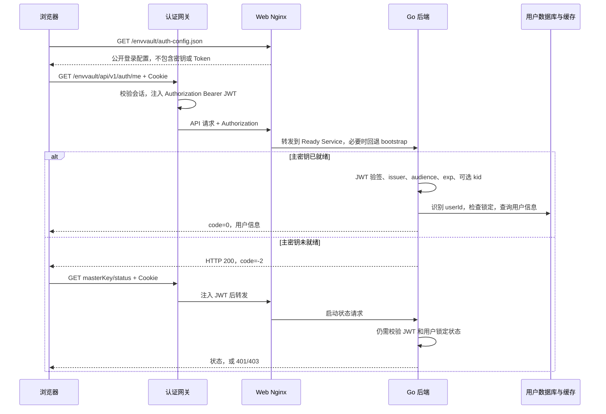

# 本地登录与外部认证网关接入

更新：2026-10-21

## 1. 处理链路



前端在页面启动前加载公开配置，`company` 模式先请求 `/auth/me`，不再把本地存储的 Token 作为公司登录前提。公司模式的浏览器请求不发送本地 Authorization，由网关在服务端一侧补充身份

`-2` 在 JWT 之前产生，不等于已认证，必须通过受保护的启动状态接口确认身份，详情见 [主密钥加载设计](master-key-loading.md)

## 2. 后端配置与验签契约

```yaml
auth:
  company:
    enabled: true
    issuer: "<实际 JWT 的 iss>"
    audience: "<实际 JWT 的 aud>"
    key_id: "" # 需要限制 kid 时填写，否则留空
    public_key: |
      -----BEGIN PUBLIC KEY-----
      <认证系统提供的 RSA 公钥>
      -----END PUBLIC KEY-----
    public_key_file: "" # 填写时优先从文件读取
```

当前只接受 `Authorization: Bearer <JWT>`，不会在后端直接解析公司 Cookie。签名算法仅允许 RS256，必须存在 exp，验证 iss、aud，并保留 30 秒时间偏差容忍；配置了 key_id 才约束 JWT Header 中的 kid

用户标识优先取字符串 `staffuserid`，为空时取字符串 `sub`，姓名取 `name`。用户标识必须与现有 `user_info.user_id` 对应；公司用户不会因验签成功而被自动创建。`/auth/me` 以数据库用户信息为准，缺少用户时返回 `user not found`

本地 `auth.local` 与公司 `auth.company` 是不同受信任签发方，可以同时开启。公司 JWT 的期限不受本地 `access_token_ttl` 的两小时设置影响，实际使用 JWT 自身 exp；Cookie 八小时不保证某个 JWT 一定有效八小时

JWT 验签后仍检查用户锁定状态；PAT 还会检查类型、数据库有效状态与归属，前端认证方式不会绕过这些逻辑。网关也应覆盖或清理外部伪造的身份 Header，后端继续独立验签

## 3. 前端可配置入口

前端仓库 `env-vault-web` 的完整配置与代码说明见该仓库 `design/authentication.md` 和 README 的“公司认证与本地登录”章节

合并部署清单中的 `env-vault-web-auth` ConfigMap：

```json
{
  "mode": "company",
  "loginUrl": "/tologin.do",
  "returnUrlParam": "url",
  "loginLabel": "公司认证",
  "logoutUrl": "",
  "logoutReturnUrlParam": "url"
}
```

HTTP 401 或业务 code=401/1401 时跳转 loginUrl，将完整原页面地址写入 returnUrlParam；参数名可改为 rd、redirect 或 service，空字符串表示不追加。HTTP 403、网络异常或协议异常显示错误和重试，不当作登录过期。30 秒内持续未认证会暂停自动跳转，避免错误配置导致循环

iframe 模式返回同源父页面，独立访问返回当前业务页面。logoutUrl 非空时退出统一会话，为空时仅清理当前应用状态，不代表平台 Cookie 已注销

运行时 JSON 覆盖构建默认配置，可复用同一镜像。首次上线需构建包含该能力的新前端镜像，之后修改 ConfigMap 并重启 Web 即可：

```bash
kubectl apply -f deploy/k8s/env-vault-statefulset.yaml
kubectl -n env-vault rollout restart deployment/env-vault-web
kubectl -n env-vault rollout status deployment/env-vault-web
```

修改后端 issuer、公钥等配置仍须重启后端 StatefulSet，后端不会动态重读 ConfigMap。不要把前端公开入口 JSON 与后端验签配置混在一起

## 4. 参考、实现范围与后续接入

本次只读参考基座 `micro-frontend-main` 和发布前端 `devops-frontend` 的 `/tologin.do?url=...` 约定，将写死的登录逻辑改为 Env Vault 的公开配置，没有修改其他模块

| 认证体系变化 | 操作 |
| --- | --- |
| 同一网关模式，登录地址或返回参数名变化 | 调整前端 ConfigMap，重启 Web，无需重建镜像 |
| JWT 的 issuer、audience、公钥或 kid 变化 | 调整后端 auth.company 并重启后端 |
| 登录页名称或统一退出入口变化 | 调整前端 ConfigMap |
| JWT 用户字段或签名算法不同 | 当前不能仅靠改 URL 接入，需映射适配或由网关统一 JWT 契约 |
| OIDC 直接登录、opaque token、远程 introspection | 需要独立协议适配层，当前不实现 |

待确认项记录在 TODO：公司统一退出地址、网关 JWT 自动刷新策略、新认证体系的签名与身份字段契约、跨域或其他基座的嵌入需求。暂未执行集群部署，也未使用真实公司账号做自动化登录
