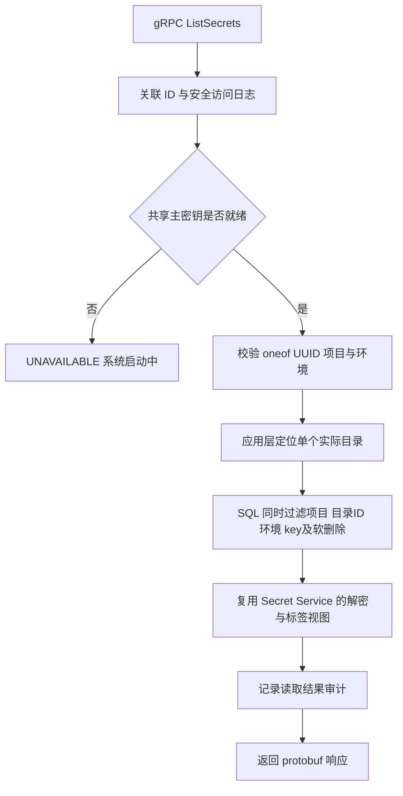

# gRPC 目录密钥读取

## 当前范围

本阶段提供 Go 后端的原生 gRPC 查询，通过目录 code、具体目录 ID 或跨环境目录组 ID，读取单个环境下的 secrets

- 服务：`envvault.v1.SecretService`
- 方法：`ListSecrets`
- 完整方法名：`/envvault.v1.SecretService/ListSecrets`
- 协议定义：[secret.proto](../api/envvault/v1/secret.proto)
- 只提供读取，不提供创建、更新、删除和历史查询
- 应用 Token 认证、目录授权和 TLS 在后续阶段接入，当前调用不要求登录 Token
- 默认不开启，开启后默认监听 `127.0.0.1:9090`
- HTTP 原有认证、查询契约和前端调用方式不变
- 当前 Mac 工作区未提供 `env-vault-client`，本阶段交付 protobuf 契约、生成的 Go 客户端、Go 服务端和调用示例，不包含 Java Starter

## 请求约定

`folderId`、`folderGroupId`、`folderCode` 属于 protobuf `oneof`，必须且只能指定一个

| 定位方式 | 必填字段 | 可选字段与规则 |
|---|---|---|
| 具体目录实例 | `folderId` | `envCode`、`projectId` 不传时从数据库推导，传入时必须与实际归属一致 |
| 跨环境逻辑目录 | `folderGroupId`、`envCode` | 项目由目录关系推导，传入 `projectId` 时必须一致 |
| 目录编码 | `folderCode`、`projectId`、`envCode` | 按项目、环境、目录 code 精确定位 |

`keyList` 为可选字段，空数组或不传表示查询该目录、该环境的全部 key，非空时使用 SQL `IN` 精确匹配，并在解密前过滤

目录不存在与空目录分开处理：前者返回 `NOT_FOUND`，后者返回成功和空 `secretList`；不存在的指定 key 不返回占位记录；已存在且值为空字符串的 key 正常返回

同一项目环境中，不同层级存在同名 code 时返回 `FAILED_PRECONDITION`，要求改用 `folderId` 或 `folderGroupId`，不随机选择其中一个目录

本接口不分页，也不自动查询子目录；目录较大时客户端可以按 `keyList` 分批读取，并按需要配置 gRPC 消息接收上限

## 返回结构

gRPC 使用 protobuf 响应和原生 gRPC status，不套用 HTTP 的 `code/msg/data` JSON 外壳；grpcurl 使用 protobuf JSON 映射，小驼峰字段名与现有 HTTP 字段含义一致

```json
{
  "folder": {
    "folderId": "<实际环境目录 UUID>",
    "folderGroupId": "<跨环境目录组 UUID>",
    "folderCode": "global",
    "projectId": "<项目 UUID>",
    "envCode": "dev"
  },
  "secretList": [
    {
      "groupId": "<逻辑密钥 UUID>",
      "key": "DB_PASSWORD",
      "remark": "数据库密码",
      "values": {
        "dev": {
          "secretId": "<具体密钥 UUID>",
          "folderId": "<实际环境目录 UUID>",
          "value": "<解密后的值>",
          "version": 1,
          "valueType": "string",
          "updateAt": "2026-10-28T01:00:00Z"
        }
      },
      "tagList": []
    }
  ]
}
```

`values` 只包含本次实际读取的一个环境；`updateAt` 使用 `google.protobuf.Timestamp`，protobuf JSON 输出为 RFC 3339 时间

## 处理链路



`router.NewApplication` 一次组装业务依赖，HTTP 和 gRPC 共用同一个 `masterkey.Manager`，不会产生两个互不一致的 Ready 状态；配置文件回退、分片激活和 Pod 间恢复均直接影响两个协议入口

新查询使用独立的 `ReadFolder` 应用方法，复用 `ListByProjectFolder` 仓储和 `buildViews` 解密视图；不复用旧 `folderGroupId` 整组查询分支，因此不会意外返回其他环境

读取结果审计在 gRPC 适配层记录，以便包含实际 gRPC 状态；绑定、UUID 和必填项校验失败不记录业务审计，遵循现有普通业务接口规则

## 状态与审计

| 场景 | gRPC status |
|---|---|
| 成功，包括空目录 | `OK` |
| 缺少定位条件、UUID 无效、项目或环境冲突 | `INVALID_ARGUMENT` |
| 目录或目标环境不存在 | `NOT_FOUND` |
| 目录 code 在不同层级重名 | `FAILED_PRECONDITION`，改用目录 ID 定位 |
| 主密钥尚未加载 | `UNAVAILABLE`，message 为 `系统启动中` |
| 调用被取消或超过 deadline | `CANCELLED` / `DEADLINE_EXCEEDED` |
| 数据库、解密、审计或未知异常 | `INTERNAL`，不返回原始数据库错误和 panic 内容 |

当前没有认证，审计主体为 `anonymous`，不会信任 metadata 中自报的用户或应用 ID；后续认证通过后再写入真实应用主体

审计写入失败时不返回密钥结果；读取审计记录实际目录、范围、结果数量、关联 ID 和状态，不记录明文、密文、Token、完整 metadata 或消息

`x-request-id` 从 metadata 透传，缺失或不合法时生成新的 UUID，并通过响应 metadata 返回；访问日志仅记录方法、状态、耗时和关联 ID

## 本地启动与调用

无需修改现有 `configs/config.yaml` 即可临时开启

macOS / Linux：

```bash
GRPC_ENABLED=true GRPC_ADDRESS=127.0.0.1:9090 go run ./cmd
```

Windows PowerShell：

```powershell
$env:GRPC_ENABLED = 'true'
$env:GRPC_ADDRESS = '127.0.0.1:9090'
go run ./cmd
```

也可在自己的配置中添加：

```yaml
grpc:
  enabled: true
  address: "127.0.0.1:9090"
```

本阶段使用明文 gRPC 连接，grpcurl 使用 `-plaintext`；反射已注册，因此调试时不必传入 `.proto` 文件

```bash
# 安装调试客户端
go install github.com/fullstorydev/grpcurl/cmd/grpcurl@latest

# 查看服务描述，不涉及密钥数据读取
grpcurl -plaintext 127.0.0.1:9090 list

# 按目录 code 查询全部 key，将占位符替换为真实项目 UUID
grpcurl -plaintext -emit-defaults -d '{"projectId":"<项目 UUID>","folderCode":"global","envCode":"dev"}' \
  127.0.0.1:9090 envvault.v1.SecretService/ListSecrets

# 按逻辑目录 ID 查询指定 key
grpcurl -plaintext -emit-defaults -H 'x-request-id: local-grpc-test' \
  -d '{"folderGroupId":"<目录组 UUID>","envCode":"dev","keyList":["DB_PASSWORD"]}' \
  127.0.0.1:9090 envvault.v1.SecretService/ListSecrets

# 按具体环境下的目录 ID 查询，环境由后端推导
grpcurl -plaintext -emit-defaults -d '{"folderId":"<具体目录 UUID>"}' \
  127.0.0.1:9090 envvault.v1.SecretService/ListSecrets
```

客户端需要设置 deadline；系统启动中可以在有界的启动等待期限内重试，参数错误不重试；同一进程复用 gRPC Channel

## 生成与验证

生成代码随仓库保存，正常构建不需要安装 protoc；修改 `.proto` 后才需要重新生成

```bash
# protoc 可通过系统包管理器安装，例如 macOS 使用 brew install protobuf
go install google.golang.org/protobuf/cmd/protoc-gen-go@v1.36.12
go install google.golang.org/grpc/cmd/protoc-gen-go-grpc@v1.6.2

# 确保两个生成插件所在的 GOBIN 或 GOPATH/bin 已加入 PATH
protoc -I api \
  --go_out=. --go_opt=module=env-vault \
  --go-grpc_out=. --go-grpc_opt=module=env-vault \
  api/envvault/v1/secret.proto

go test ./internal/interfaces/grpcserver ./internal/application/secret \
  ./internal/infrastructure/persistence/secret ./internal/infrastructure/persistence/folder \
  ./internal/infrastructure/config ./internal/interfaces/router
```

协议已预留 Java 包名 `net.qiuer.envvault.v1`，Java SDK 后续可从同一份 proto 生成消息和 Stub，不手工重复定义 DTO

2026-10-28 已通过 `go test ./...`、`go vet ./...`，以及 gRPC、Secret 应用层、目录与密钥仓储、配置和路由包的 `go test -race` 检查

协议测试使用生成的 Go Client、内存监听器和真实 HTTP/2 / protobuf 传输；应用层验证实际加解密，SQL 层使用 sqlmock 校验环境和目录过滤，未对现有集群执行部署或修改业务数据

## 部署边界与后续扩展

本阶段不修改现有 Kubernetes Service、Ingress 和 Web Nginx 路由；容器间接入时需将监听地址配置为 `0.0.0.0:9090`，增加对应 Service 端口，并根据访问位置配置原生 gRPC / HTTP2 转发

后续认证在 gRPC interceptor 中接入应用 Token，目录与环境授权在共享应用入口校验；不得只在 Java SDK 侧过滤范围，也不得复用集群主密钥传输 Token 作为应用 Token

Java Starter 的 `${envvault.目录.KEY}` 解析、应用凭证管理、TLS、外部网关路由和配置订阅均不属于本次实现
