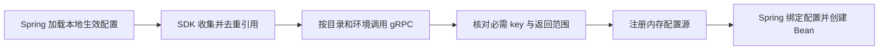

# Java SDK 与应用接入设计

## 阶段与当前状态

目标应用使用 Spring Boot 3.x，在启动期间解析配置中的 Env Vault 引用，避免应用自行管理密钥明文文件

| 能力 | 状态 |
|---|---|
| Go 原生 gRPC 读取单个目录、单个环境的 secrets | 已实现，见 [gRPC 契约与调用说明](grpc-secret-read.md) |
| Java Client 与 Spring Boot Starter | 待开发 |
| 独立应用身份、凭证及目录环境授权 | 待开发 |
| TLS、Kubernetes gRPC Service 和网关接入 | 待开发 |
| 多目录批量读取、配置订阅和热更新 | 后续按需求设计 |

完整讨论原稿和 HTML 见 [2026-10-28 归档](archive/20261028/README.md)，本文件与 gRPC 接口文档记录当前方案，历史页面不作为已实现功能的承诺

## 配置引用与加载

使用 Spring `${...}` 引用语法，推荐为 Env Vault 增加明确命名空间，下面为待实现的 SDK 使用示意

```yaml
envvault:
  address: "${ENV_VAULT_GRPC_ADDRESS}"
  project-id: "${ENV_VAULT_PROJECT_ID}"
  env-code: "${ENV_VAULT_ENV}"
spring:
  datasource:
    username: "${envvault.global.DB_USERNAME}"
    password: "${envvault.global.DB_PASSWORD}"
```

`global` 表示目录 code，`DB_PASSWORD` 表示精确匹配的 key；项目和环境由 SDK 启动配置提供，应用凭证字段待认证契约确定后补充

计划通过 `EnvironmentPostProcessor` 在 Boot ConfigData 加载后、业务 Bean 创建前读取生效配置，收集引用并按目录去重、批量获取，再注册内存 PropertySource，随后由 Spring 解析引用并绑定配置



SDK 不改写源码 YAML、target/classes、JAR 内文件，也无需取得服务端 AES 主密钥或密钥分片；首版以启动快照提供属性，读取属性时不发起网络请求，不使用远端引用决定 Profile 和配置导入路径

## 本地与容器

本地修改 `src/main/resources/application.yaml` 后，通过正常 IDE 或 Maven 资源复制并重新启动，SDK 不编辑编译产物

容器可使用以下目录结构，外部 YAML 也保留引用

```text
/app/
  app.jar
  config/
    application.yaml
```

Spring Boot 的 `./config/` 相对于进程工作目录，为消除启动目录差异，可显式指定

```bash
java -jar /app/app.jar --spring.config.additional-location=file:/app/config/
```

首版中，Env Vault 值变更后重启应用即可重新读取；修改 JAR 内配置或 Java 代码需要重新构建；挂载配置变更后仍需重新启动，不承诺自动刷新已创建的 Bean

## 应用认证与授权

人员登录、PAT 和应用访问使用不同主体：本地或公司登录以及 PAT 代表用户，部署应用使用独立应用凭证，不能依赖员工浏览器会话

Token 用于证明身份，folder ID 用于指定资源，知道目录 ID 不表示获得读取授权；后续按应用、目录组、环境、`secret:read` 的组合授权，服务目录与 global 分别授权，开发与生产使用独立凭证

应用 Token 可以使用高强度随机值，不强制复用人员 JWT；凭证需要支持到期、撤销和应用禁用，后续可评估 OAuth Client Credentials

gRPC metadata 用于携带认证信息，业务消息只保留查询条件；服务端 interceptor 校验凭证，共享应用层校验目录和环境权限，审计写入可信应用主体，不信任客户端自报身份

当前阶段按已确认范围先提供无应用认证的 `ListSecrets`，审计主体为匿名，监听默认关闭、开启后默认 `127.0.0.1:9090`；主密钥未就绪时返回 `UNAVAILABLE`，不跳过就绪检查

## 客户端约定与扩展

- 缺少必需 key 或环境时停止启动，保留存在但为空字符串的值，由业务配置校验决定是否合法
- 配置单次调用 deadline、启动总超时和有限重试，参数错误及后续认证授权失败不无限重试
- 复用 gRPC Channel，日志只记录目录、key、版本、请求标识和耗时，不记录 Token 或密钥明文
- 优先交付基础客户端与 Spring Boot Starter，复用 [secret.proto](../api/envvault/v1/secret.proto) 生成消息与 Stub
- 集群内调用需配置 gRPC 监听地址与 Service 端口，外部调用还需 TLS 和原生 gRPC 路由，现有 Web Nginx HTTP/1.1 代理链不能直接作为 gRPC 链路

## 参考

- [Spring Boot 启动环境扩展](https://docs.spring.io/spring-boot/3.5/api/java/org/springframework/boot/env/EnvironmentPostProcessor.html)
- [Spring Boot 外部配置](https://docs.spring.io/spring-boot/3.5/reference/features/external-config.html)
- [gRPC 认证](https://grpc.io/docs/guides/auth/)、[deadline](https://grpc.io/docs/guides/deadlines/)
